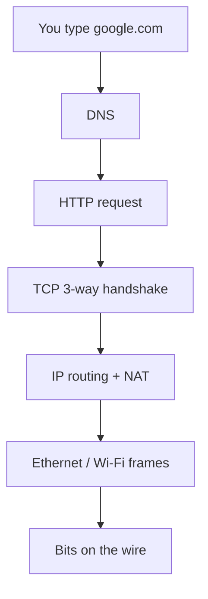

---
aliases:
  - Networking
  - Index
  - Home
tags:
  - networking/moc
creation_date: 2026-11-24
---

# 🌐 Networking MOC

Map of content for everything networking. Read top to bottom for a learning path.

## 1 · Fundamentals
- [[Internet Traffic]]: speeds, upload/download, guided vs unguided
- [[Network Types]]: LAN / MAN / WAN
- [[Network Topologies]]: bus, ring, star, tree, mesh
- [[Network Devices]]: modem, router, ISP
- [[IP Address]] → [[NAT]] → [[Port Numbers]]

## 2 · OSI Model
[[OSI]] overview, then bottom up:
[[Physical layer]] → [[Data Link layer]] → [[Network layer]] → [[Transport layer]] → [[Session layer]] → [[Presentation layer]] → [[Application layer]]

## 3 · TCP/IP Model
- [[TCP-IP Model]]
- [[Client-Server and P2P]]
- [[TCP-IP Transport Layer]]: [[Checksum]] · [[Timers]] · [[Congestion Control]]
- [[Processes Threads Sockets]] · [[Ephemeral Ports]]

## 4 · Protocols
- [[Protocols Overview]]
- [[HTTP]] · [[Cookies]]
- [[DNS]]
- [[Email Protocols]]
- [[TCP]] · [[TCP 3-Way Handshake]] · [[UDP]]

## 5 · Resources
- [[Kunal's PDFs Index]]

## The big picture

## Still to write
- [ ] DHCP, FTP, SSH, VNC, Telnet
- [ ] Subnetting + CIDR, IPv6
- [ ] TLS / HTTPS handshake
- [ ] Switch / hub / firewall detail
- [ ] See [[Corrections Log]] for what was fixed
