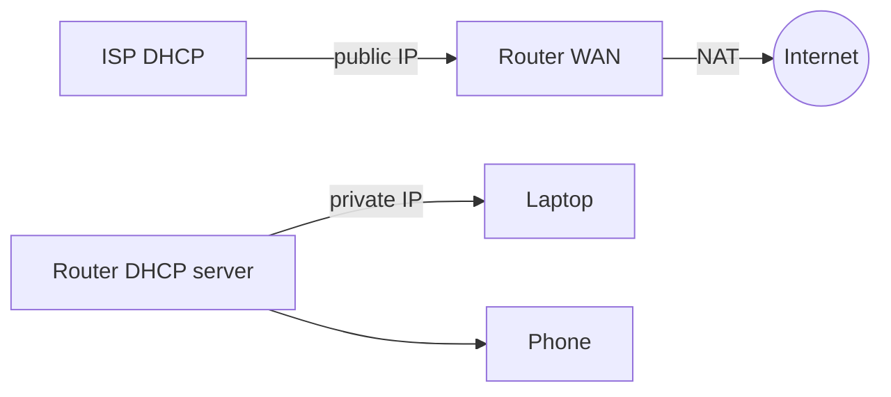

---
aliases:
  - IP
  - Global IP
  - Public IP
  - Private IP
  - IP_Addressing_and_Subnetting
tags:
  - networking/fundamentals
  - networking/addressing
creation_date: 2026-11-04
source: scrib2
up: "[[Networking MOC]]"
---

# IP Address

**IP** = Internet Protocol. An IP address is an identification number for a device on a network. It works at the [[Network layer]].

## IPv4 anatomy
- **Length:** 32 bits
- **Format:** 4 sections (octets), each `0–255`, separated by dots
- **Size as text:** 4–12 digits (7–15 characters with the dots)
- Example: `192.168.1.50`

[More info on IP addresses](https://www.geeksforgeeks.org/computer-science-fundamentals/what-is-an-ip-address/)

## Public (global) vs private
| | Public / Global IP | Private IP |
| --- | --- | --- |
| Seen by | The whole internet | Only inside your [[Network Types\|LAN]] |
| Assigned by | ISP (usually via DHCP) | Your router's DHCP server |
| Example | `49.x.x.x` (varies) | `192.168.1.50` |

The router has two faces: a **public IP on the WAN side** and a **private IP on the LAN side** (commonly the gateway `192.168.1.1`). `192.168.1.0` is the *network address* of that LAN, not the global IP.

> [!warning] Correction
> Scrib said the global IP is `192.168.1.0`. That range is **private** (RFC 1918: `10.0.0.0/8`, `172.16.0.0/12`, `192.168.0.0/16`). The global IP is the one your ISP gives the router.

## How you get an IP

- The ISP assigns the router's public IP (DHCP).
- The router hands private IPs to your devices (DHCP).
- [[NAT]] lets all of them share the one public IP.

## IP + port = socket
An IP finds the machine, a [[Port Numbers|port]] finds the program: `192.168.1.50:8080`. See [[Processes Threads Sockets]].

> [!todo] Not yet covered
> Subnetting (CIDR, subnet masks) and IPv6. The original filename promised subnetting, but no notes existed on it.
