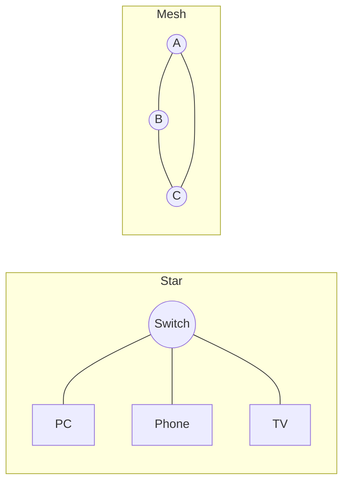

---
aliases:
  - Topologies
  - Bus
  - Ring
  - Star
  - Tree
  - Mesh
tags:
  - networking/fundamentals
  - networking/topology
creation_date: 2026-11-06
source: scrib2
up: "[[Networking MOC]]"
---

# Network Topologies

How devices are physically or logically arranged.

## 1. Bus
Everything runs off **one backbone cable**. If that main line snaps, the whole network goes down.

## 2. Ring
Devices chained in a **closed circle**. Data loops node to node in one direction.

## 3. Star
Everything connects to **one central hub or switch**, like all your devices on a home router. The most common LAN layout today.

## 4. Tree
**Star + Bus** combined. Multiple star networks hanging off one main bus line, forming a hierarchy.

## 5. Mesh
**Every node connects to every other node.** Very fault-tolerant, but expensive and hard to scale because the wiring explodes as hardware grows (n nodes → n(n−1)/2 links).

## Comparison
| Topology | Strength | Weakness |
| --- | --- | --- |
| Bus | Cheap, simple | Backbone = single point of failure |
| Ring | Orderly data flow | One break can disrupt the loop |
| Star | Easy to manage, one device failing is isolated | Central hub/switch is the single point of failure |
| Tree | Scales by hierarchy | Depends on the backbone |
| Mesh | Highly fault-tolerant | Expensive, scalability issues |

Related: [[Network Types]] · [[Network Devices]]
