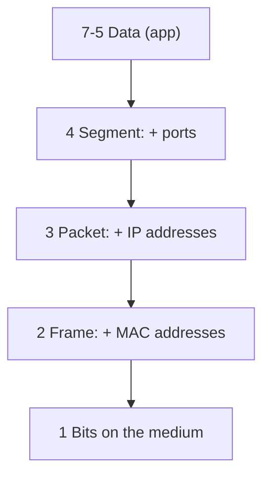

---
aliases:
  - OSI Model
  - Structure of the Network
tags:
  - networking/osi
creation_date: 2026-11-06
source: scrib2
up: "[[Networking MOC]]"
---

# OSI Model

**Open Systems Interconnection.** A conceptual framework that splits network communication into **7 layers**, each with one job.

> [!warning] Correction
> Scrib expanded it as "open systems internet". It's Open Systems **Interconnection**.

- **Conceptual framework.** It's for understanding networking, not a literal implementation.
- **Modular.** Swap tech at one layer (Token Ring → Ethernet) without touching the others.
- **Troubleshooting map.** Find which layer the problem lives in, then fix it. *"Without understanding the OSI model it becomes hard to conceptualize networking."* ([source](https://www.reddit.com/r/networking/comments/po4ik/comment/c3qym2t/))

## The 7 layers (top → bottom)
| # | Layer | Job | PDU | Examples |
| --- | --- | --- | --- | --- |
| 7 | [[Application layer]] | What the user's software talks to | Data | HTTP, SMTP, DNS |
| 6 | [[Presentation layer]] | Translate, compress, encrypt | Data | TLS/SSL, JPEG |
| 5 | [[Session layer]] | Open, manage, close sessions | Data | Checkpoints, sync |
| 4 | [[Transport layer]] | End-to-end delivery, ports | Segment / Datagram | [[TCP]], [[UDP]] |
| 3 | [[Network layer]] | Logical addressing, routing | Packet | IP, routers |
| 2 | [[Data Link layer]] | Local delivery via MAC | Frame | Ethernet, switches |
| 1 | [[Physical layer]] | Bits on the wire | Bits | Cables, signals |

**Mnemonic (top→bottom):** *All People Seem To Need Data Processing.* Bottom→top: *Please Do Not Throw Sausage Pizza Away.*

> [!tip] Reality check
> Layers 1–4 are what you worry about in practice. 5–7 are typically handled by the OS or the application itself. *"The only layers you really need to worry about in networking are 1-4."* ([source](https://www.reddit.com/r/networking/comments/2u3pze/comment/co4vhid/))

## Encapsulation: data going down the stack

Each layer wraps the one above with its own header. The receiver unwraps in reverse.

## OSI vs TCP/IP
| OSI (7) | [[TCP-IP Model\|TCP/IP]] (5-layer teaching version) |
| --- | --- |
| Application, Presentation, Session | Application |
| Transport | Transport |
| Network | Network |
| Data Link | Data Link |
| Physical | Physical |

- OSI is the idealized model; TCP/IP is what real networks run. Learn both.
- Engineers still say "Layer 2 / Layer 3" even in TCP/IP environments.
- Layer 8 (the user) is the joke layer. *"While troubleshooting, 90% are a Layer 8 issue."*

> [!quote]- Original raw research (collapsed)
> Source summary lives in [[_Archive/original-notes/OSI|the archived OSI note]]. Reddit-sourced bullets on modularity, TCP/IP vs OSI, mnemonics, and troubleshooting.
