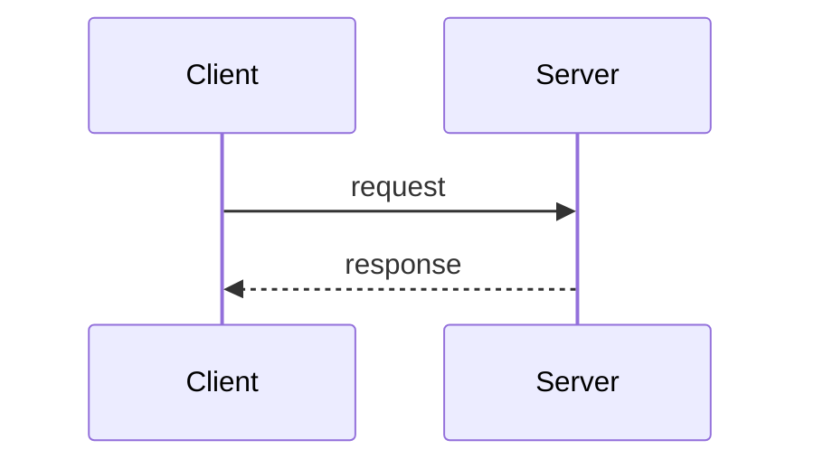

---
aliases:
  - Client Server
  - Peer to Peer
  - P2P
  - Application Layer (TCP/IP)
tags:
  - networking/tcpip
  - networking/application
creation_date: 2026-11-24
source: scrib2
up: "[[TCP-IP Model]]"
---

# Client-Server and P2P

Application layer architectures: *where* and *which devices* do the work.

## 1. Client-Server
- **Server**: a system that hosts an application/service and controls access to it.
- **Client**: the service receiver.

Example: browser ([[HTTP]]) ↔ web server.

## 2. Peer-to-Peer (P2P)
Decentralized. A machine can be **both host and client** at once. How torrents work: you download pieces from peers while uploading pieces to others.

| | Client-Server | P2P |
| --- | --- | --- |
| Control | Centralized | Decentralized |
| Single point of failure | Yes (the server) | No |
| Scaling | Server needs more capacity | More peers = more capacity |

Next: [[Protocols Overview]]
