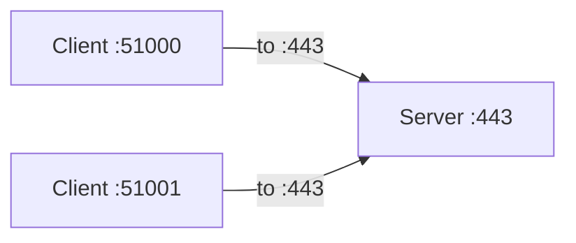

---
aliases:
  - Ephemeral Port
  - Dynamic Ports
tags:
  - networking/tcpip
  - networking/ports
creation_date: 2026-11-24
source: scrib2
up: "[[Port Numbers]]"
---

# Ephemeral Ports

A temporary, short-lived [[Port Numbers|port]] your OS **automatically assigns to a client app** when it makes an outbound connection.

> [!info] Analogy
> A server's well-known port (e.g. `443`) is a public hotline. The ephemeral port is the **caller ID / temporary burner number** your computer uses so the server knows where to send the response.

**Why:** lets one client keep **multiple simultaneous connections** to one server (even the same server port), each with different data in flight.



- IANA range: `49152`–`65535`
- Linux default is different (`32768`–`60999`):
  ```bash
  cat /proc/sys/net/ipv4/ip_local_port_range
  ```

Related: [[Processes Threads Sockets]] · [[NAT]]
