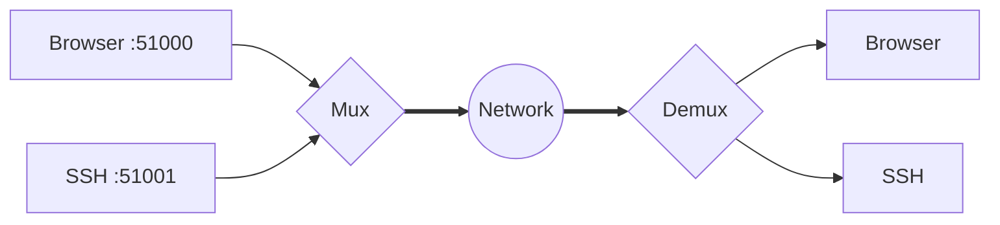

---
aliases:
  - Multiplexing
  - Demultiplexing
  - Transport Layer (TCP/IP)
tags:
  - networking/tcpip
  - networking/transport
creation_date: 2026-11-24
source: scrib2
up: "[[TCP-IP Model]]"
---

# Transport Layer (TCP/IP)

Moves data from the network **up to the correct application on the machine**, and the reverse. Same job as OSI's [[Transport layer]].

## Multiplexing / demultiplexing
Many apps share one machine and one [[IP Address]]. Data travels in packets, so the transport layer attaches **source and destination [[Port Numbers|port numbers]]** to each.

- **Multiplexing (sender)**: collects data from several apps, adds headers with ports, passes it down.
- **Demultiplexing (receiver)**: reads the destination port and hands data to the right [[Processes Threads Sockets|socket]].

## Responsibilities
- Reliable delivery (or knowingly not)
- Error detection: [[Checksum]]
- Loss detection: [[Timers]] + sequence numbers
- Flow and [[Congestion Control]]

## Protocols
| | [[TCP]] | [[UDP]] |
| --- | --- | --- |
| Connection | Connection-oriented | Connectionless |
| Reliable & ordered | Yes | No |
| Speed | Slower | Faster |
