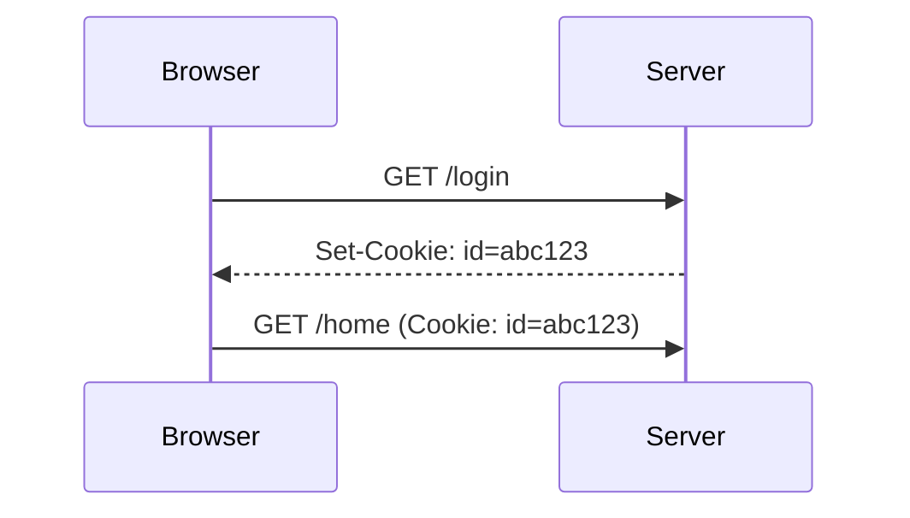

---
aliases:
  - Cookie
  - Third-party Cookies
tags:
  - networking/protocols
  - networking/application
creation_date: 2026-11-24
source: scrib2
up: "[[HTTP]]"
---

# Cookies

A small unique string a server gives your browser, **stored locally**, and sent back with later requests. This is how stateless [[HTTP]] "remembers" you (logins, carts, sessions).

## Third-party cookies
Set by a domain **other than the site you're visiting**, e.g. an ad or tracker embedded on the page. They can follow you across sites, which is why browsers are phasing them out.
