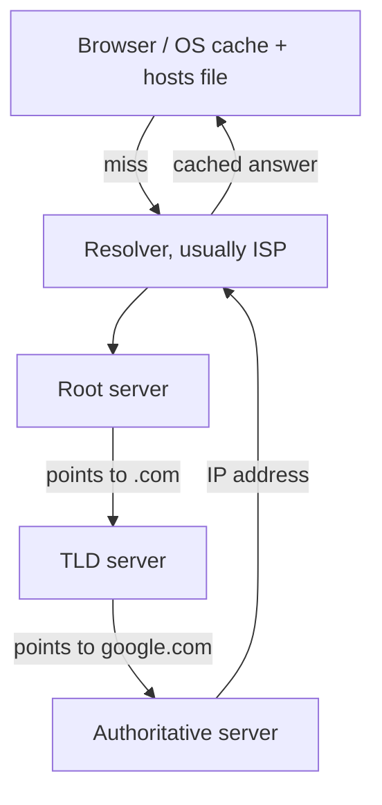

---
aliases:
  - Domain Name System
tags:
  - networking/protocols
  - networking/application
creation_date: 2026-11-24
source: scrib2
up: "[[Protocols Overview]]"
---

# DNS

**Domain Name System.** A directory/database service that finds the [[IP Address]] of a website's server from its name. Part of the application layer.

When you type `www.google.com`, [[HTTP]] hands the domain to DNS, gets the IP back, then connects to that server.

DNS is multi-level and spread across many servers, which makes it robust and resistant to downtime.

## Anatomy of a domain
`mail.google.com`

| Part | Role |
| --- | --- |
| `mail` | Subdomain |
| `google` | Second-level domain |
| `com` | Top-level domain (TLD) |

Each level is served by different servers.

## What happens when you type google.com


![[Pasted image 20261122175715.png]]

> [!warning] Correction
> Scrib grouped "TLD / Root servers" together. They're separate levels: **Root** (knows who runs each TLD) → **TLD** (`.com`, `.io`, `.org`; knows who runs each domain) → **Authoritative** (has the actual record).

Transport: mostly [[UDP]] port 53 (fast, tiny queries), [[TCP]] for large responses.

```bash
dig +trace google.com    # watch the whole resolution chain
```
