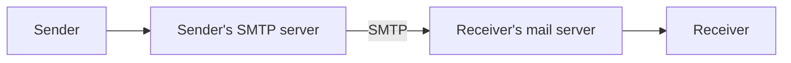

---
aliases:
  - SMTP
  - POP3
  - IMAP
  - How Email Works
tags:
  - networking/protocols
  - networking/application
creation_date: 2026-11-24
source: scrib2
up: "[[Protocols Overview]]"
---

# How Email Works

- **Application layer:** SMTP to send, POP3 or IMAP to receive
- **Transport layer:** [[TCP]], because it's lossless and you don't want to lose any email

## Sending: SMTP
Simple Mail Transfer Protocol.


The sender's server holds the message until it can reach the receiver's server. Same platform: sender → server → receiver.

## Receiving
### POP3 (Post Office Protocol)
Client authorises with the server, then downloads mail. Usually stored on that one device.
```
client ---authorise---> POP server
       <---transaction---
```

### IMAP (Internet Message Access Protocol)
Mail stays on the server, and **multiple devices stay in sync**. Better for phone + laptop.

| | POP3 | IMAP |
| --- | --- | --- |
| Mail kept | Downloaded to device | On server |
| Multi-device | Poor | Syncs |
| Port | 110 | 143 |

Related: [[Protocols Overview]]
