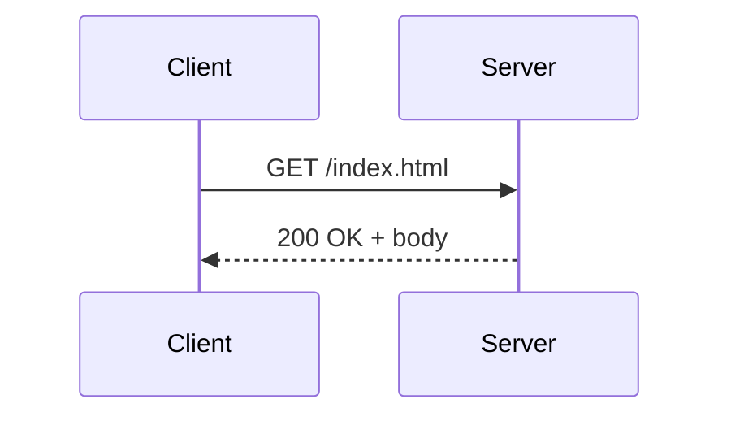

---
aliases:
  - HTTPS
  - HTTP Methods
  - Status Codes
tags:
  - networking/protocols
  - networking/application
creation_date: 2026-11-24
source: scrib2
up: "[[Protocols Overview]]"
---

# HTTP

Application-layer protocol for the web. Client sends a request, server sends a response ([[Client-Server and P2P]]).

- Runs on **[[TCP]]** (HTTP/3 is the exception: it uses QUIC over [[UDP]])
- **Stateless**: each request is independent. The server doesn't remember you. [[Cookies]] bolt state on top.

| Layer | Protocol |
| --- | --- |
| Application | HTTP |
| Transport | TCP |

## Methods
| Method | Use |
| --- | --- |
| `GET` | Fetch a resource |
| `POST` | Send data / create |
| `PUT` | Replace / update |
| `DELETE` | Remove |

## Status codes
| Range | Category | Examples |
| --- | --- | --- |
| `1xx` | Informational | 100 |
| `2xx` | Success | 200 OK |
| `3xx` | Redirection | 301, 302 |
| `4xx` | Client error | 404, 403 |
| `5xx` | Server error | 500, 503 |

Before any request, [[DNS]] turns the domain into an IP. HTTPS = HTTP over TLS, after the [[TCP 3-Way Handshake]].
