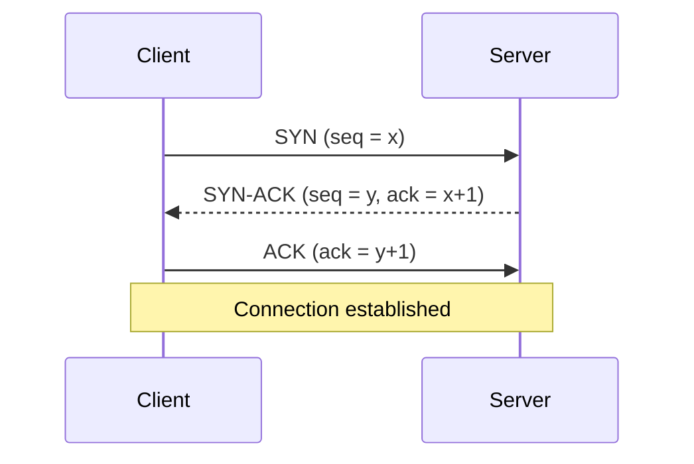

---
aliases:
  - 3-way handshake
  - Three-way handshake
tags:
  - networking/protocols
  - networking/transport
creation_date: 2026-11-24
source: scrib2
up: "[[TCP]]"
---

# TCP 3-Way Handshake

The three-step process [[TCP]] uses to **establish a reliable, synchronized connection** between two hosts before any actual data is sent.

1. **SYN**: client says "let's talk", sends its initial sequence number.
2. **SYN-ACK**: server acknowledges it and sends its own sequence number.
3. **ACK**: client acknowledges the server's number. Data can flow.

Sequence numbers are how both sides track bytes later (see [[Timers]]).

![[Pasted image 20261124191019.png]]

## HTTPS request
`Client → sequence number → Server`: the client's first packet carries its initial sequence number. For [[HTTP|HTTPS]] the order is: TCP handshake → TLS handshake → encrypted HTTP request.

## Teardown
Connections close with `FIN` / `ACK` exchanges, then [[Timers|TIME_WAIT]].

> [!todo] Scrib ended mid-thought
> Last scribble was a video timestamp `3:10:02`. Add the rest of the handshake notes from that lecture.
